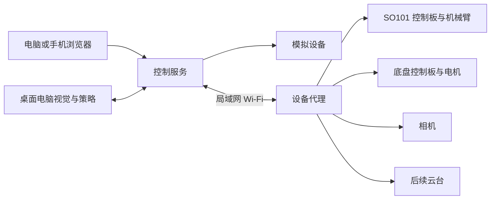

# 机械臂与小车网页控制平台

建立一个通过浏览器统一操作 SO101 机械臂、小车、相机及后续云台的个人机器人项目。代码和开发任务放到 GitHub 管理，先在云端完成可运行的模拟控制台，再在家中的 Ubuntu 电脑及车载主控上接入真实设备。

长期应用场景是让小车搭载机械臂，在室内寻找袜子等物品，停车后识别、抓取并放入容器。第一阶段先实现可观察、可停止的手动控制，再推进视觉定位与自动任务。

## 当前基础

截至 2026 年 11 月 4 日，用户已确认拥有 SO101 主从臂、机械臂控制板和一个相机；希望电脑留在桌面，通过 Wi-Fi 与车端通信，并希望降低车载主控成本。小车、车载 Linux 主控及云台尚无已确认的采购型号。

项目仓库为 https://github.com/fellixburst/roboarm 。目前完成项目文档初始化，网页控制程序尚未实现。已有硬件不等于控制、标定与自动抓取已完成。

## 第一版范围

- 总览：设备在线状态、连接模式、故障信息和最近操作。
- 机械臂：关节状态、限速点动、夹爪操作、停止；真实关节范围从标定配置读取。
- 小车：前后左右操作、速度限制、松手停止、失联停车。
- 相机：视频预览、连接状态、抓图；模拟画面明确标注。
- 日志：命令接收、执行结果、拒绝原因和断线事件。
- 模拟模式：无硬件也能操作完整流程，支持注入断线、过期命令和设备故障。

第一版不以自动导航、自动抓取或模型训练成功为验收条件。云台与多设备扩展保留接口，待硬件明确后接入。

## 系统分工

云端用于开发、模拟测试和版本管理。真机接入初期，控制服务和设备代理可以先运行在现有 Ubuntu 电脑上；移动化后，将设备代理迁到车载 Linux 主控。桌面电脑承担视觉计算和策略，车端承担采集、设备通信和本地超时处理。

GitHub 存储代码及文档。把网页发布出来并不自动获得家中 USB 设备的控制能力；跨互联网控制属于后续部署阶段，需要认证和设备侧主动建立的受控连接。

## 文档导航

- [项目构想与需求](docs/PROJECT_BRIEF.md)
- [现状与开发进程](docs/ROADMAP.md)
- [云端开发任务书](docs/CLOUD_TASK.md)

本仓库当前交付为项目定义与开发任务书，尚无可运行应用。
